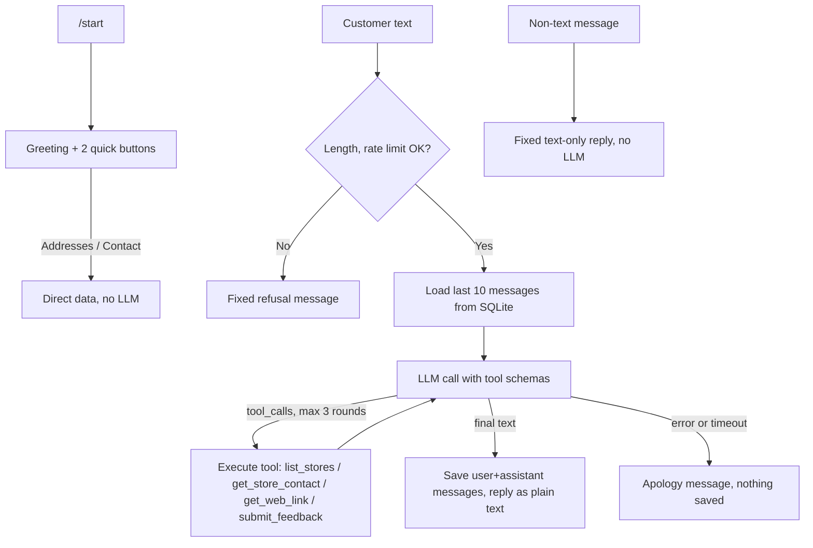

# ARCHITECTURE.md — System design and decisions

## 1. Scope
Telegram customer-support bot for a cafe chain, built with Python and `python-telegram-bot` v20+. An LLM agent (third-party, OpenAI-compatible API) answers customers using a fixed set of tools. There is no human agent in the flow. Target: demo / coursework scale, not a production helpdesk.

## 2. User flow

## 3. Architecture decisions (ADR)

### ADR-01 — python-telegram-bot v20+
Async handlers. `ConversationHandler` is no longer used: every text message goes to the agent.

### ADR-02 — Inline buttons as shortcuts
Two buttons (addresses, contact) call stores data directly, avoiding LLM cost and latency.

### ADR-03 — Contact card for phone calling
`send_contact` with an international number plus vCard. Telegram rejects `tel:` in inline-button URLs. Contact messages cannot be edited, so menus navigating away from them delete and resend.

### ADR-04 — Environment configuration
Secrets and endpoints (`BOT_TOKEN`, `LLM_API_KEY`, `LLM_MODEL`, `LLM_BASE_URL`, `MENU_URL`) come from env via `python-dotenv`.

### ADR-05 — Store configuration in JSON
Branches live in `data/stores.json`, validated at startup (required fields, `+` phone).

### ADR-06 — LLM agent with a closed tool set
**Decision:** `cskh/agent.py` runs a bounded loop (3 tool rounds, then a forced text answer) over the OpenAI SDK with a configurable `base_url`. Tools in `cskh/tools.py`: `list_stores`, `get_store_contact`, `get_web_link` (pickup/reservation/member pages of the shop website), `submit_feedback`. No other capability is reachable. The system prompt is built at startup from `data/faq.md` (shop operating rules) and `SHOP_NAME`.
**Reason:** Provider-agnostic, cheap to demo, and facts about branches come from tools rather than model memory.
**Guardrails:** system prompt restricts scope and role changes; 10 msgs/min/user; 1000 chars/message; LLM output is sent as plain text (no `parse_mode`) because it is untrusted; LLM failure yields an apology and stores nothing.

### ADR-07 — SQLite via aiosqlite
**Decision:** `data/cskh.sqlite3` with `users`, `messages`, `feedback`. The agent reads the 10 most recent messages as context. Messages older than 30 days are purged daily. There is no user-facing data deletion command.
**Reason:** Zero-ops persistence that can be opened directly during a demo.

### ADR-08 — Docker
`Dockerfile` (python:3.12-slim, non-root uid 1000) and `docker-compose.yml` mounting `./data`. Polling mode; no webhook or reverse proxy.

### Removed: human agent forwarding
The earlier starter forwarded customer text to `AGENT_CHAT_ID` and had a chat mode with `/cancel`. Removed in favor of the AI agent; feedback is stored in SQLite instead.

## 4. Main components
- `bot.py`: wiring, DB lifecycle, daily purge task, polling.
- `cskh/config.py`: `Settings` from env.
- `cskh/stores.py`: load/validate stores, HTML address text, vCard.
- `cskh/db.py`: SQLite schema and queries.
- `cskh/tools.py`: tool schemas and execution.
- `cskh/agent.py`: system prompt and agent loop.
- `cskh/ratelimit.py`: sliding-window limiter.
- `cskh/handlers.py`: Telegram handlers.
- `tests/`: unit tests for stores, DB, rate limiter, and the agent loop with a fake LLM.

## 5. Known limitations
- Updates are processed sequentially, so one slow LLM call delays other customers. Fine for demo load.
- Rate limiter state is in memory and resets on restart.
- Only text is handled; media gets a fixed reply.
- Example store data and phone numbers are placeholders; `MENU_URL` defaults to `shop.example.com`.
- `data/faq.md` is derived from the shop's QR-Order-Pay docs; update it whenever the shop's rules change.
- Real Telegram and LLM calls are not covered by automated tests.
